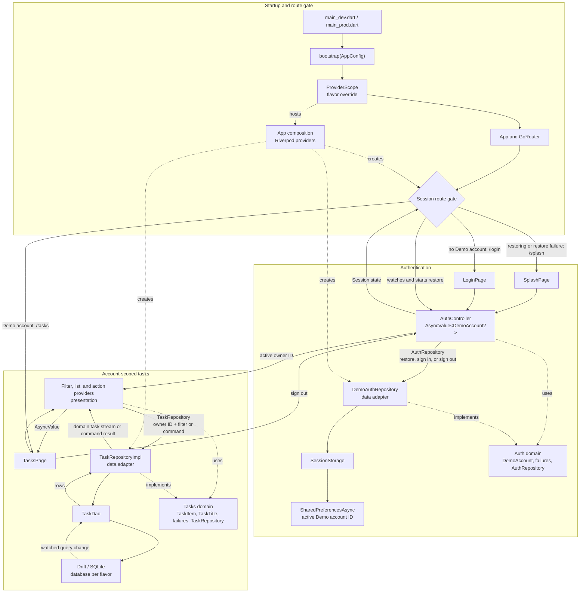

# Flutter Clean Architecture Example

This repository is a runnable, product-shaped teaching reference for an
intermediate Flutter developer. It demonstrates a small local task product
with an explicit Clean Architecture dependency direction and a complete,
testable user flow.

It is a reference implementation, not a reusable template or a production
authentication system. The Demo credentials are public by design and must not
be reused for a real application.

## Product scope

- Deterministic local sign-in with the public Alice and Bob Demo accounts.
- Session restore and sign-out.
- Account-scoped task creation, renaming, completion, deletion, and filtering.
- Persistent SQLite tasks through Drift; only the active account ID is stored
  with `SharedPreferencesAsync`.
- English and human-reviewed Simplified Chinese UI localization.
- Android and iOS `dev`/`prod` flavors with separate application identity and
  database names.

There is intentionally no backend, OAuth flow, registration, password reset,
token refresh, biometric login, search, synchronization, telemetry, release
signing, publishing, web target, or desktop target.

## Technology responsibilities

| Concern | Package or SDK | Responsibility |
| --- | --- | --- |
| State and composition | Riverpod | Reactive state and dependency composition |
| Immutable models | Freezed | Value-based immutable domain models |
| Navigation | go_router | Session route gate and three app routes |
| Local persistence | Drift | Typed SQLite schema, queries, and change streams |
| Session preference | shared_preferences | Non-sensitive active Demo account ID |
| Localization | Flutter l10n and intl | English and human-reviewed Simplified Chinese presentation text |

The feature layers are `domain`, `data`, and `presentation`. `lib/app` is the
composition and routing boundary. Domain code does not know about Flutter,
Drift, or platform adapters; presentation does not import data implementations.
There is no empty application layer or generic use-case/repository hierarchy.

## Architecture at a glance



Solid arrows show runtime control or data flow. Dashed arrows show source-code
dependencies on domain contracts and Riverpod composition wiring; their labels
make those roles explicit. Domain code remains independent of Flutter and
storage adapters. Task commands write through the repository, while the watched
Drift query—not a manually maintained UI cache—feeds updated domain tasks back
to the list provider. See [Architecture](docs/architecture.md) for provider
rebuild boundaries, failure handling, and persistence details.

## Toolchain

The current declared dependency baseline targets Flutter `3.47.5` stable,
Dart `3.13.4`, Gradle `9.3.1`, Android Gradle Plugin `9.1.0`, and Kotlin
Gradle Plugin `2.4.0`. Android source and Kotlin JVM targets use Java `17`; the
host JDK must satisfy the selected Gradle version. The committed lockfile is
part of the candidate baseline; call it verified only after the complete local
quality and platform checks pass. Check the installed SDK before starting:

```bash
flutter --version
dart --version
```

## Run

```bash
flutter pub get
dart run build_runner build
flutter gen-l10n
flutter run --flavor dev -t lib/main_dev.dart
```

Use the production flavor with:

```bash
flutter run --flavor prod -t lib/main_prod.dart
```

Demo credentials:

```text
alice@example.com / demo1234
bob@example.com   / demo1234
```

## Verify

```bash
dart run build_runner build
flutter gen-l10n
git diff --check
dart format --output=none --set-exit-if-changed lib test integration_test
dart analyze --fatal-infos --fatal-warnings
flutter test
```

Build the flavors where the platform toolchain is available:

```bash
flutter build apk --debug --flavor dev -t lib/main_dev.dart
flutter build apk --debug --flavor prod -t lib/main_prod.dart
flutter build ios --simulator --no-codesign --flavor dev -t lib/main_dev.dart
flutter build ios --simulator --no-codesign --flavor prod -t lib/main_prod.dart
```

Run the Android end-to-end flow on an emulator or device:

```bash
flutter test integration_test -d <device-id>
```

The commands above form the manual verification matrix for this candidate
baseline. They do not sign or publish release artifacts.

## Project structure

```text
lib/
├── app/                         # Bootstrap, composition, routing, theme
├── core/                        # Small cross-feature Result and storage failure
├── features/
│   ├── auth/
│   │   ├── domain/              # Account model, catalog, failures, contract
│   │   ├── data/                # Demo adapter and session storage
│   │   └── presentation/        # Auth controller, splash, and login UI
│   └── tasks/
│       ├── domain/              # Task model, filter, title, failures, contract
│       ├── data/                # Drift schema, DAO, and repository
│       └── presentation/        # Task providers, actions, editor, and list UI
└── l10n/                        # ARB sources and generated localizations
```

Read the documentation in this order:

1. [Domain vocabulary](CONTEXT.md)
2. [Architecture](docs/architecture.md)
3. [Development guide](docs/development.md)
4. [Testing strategy](docs/testing.md)
5. [Tasks walkthrough](docs/tasks-walkthrough.md)
6. [Architecture decisions](docs/adr/)

Riverpod, Freezed, Drift, and localization outputs are committed for
discoverability. Regenerate them from their source files; do not edit generated
Dart files by hand.

## License

[MIT](LICENSE)
